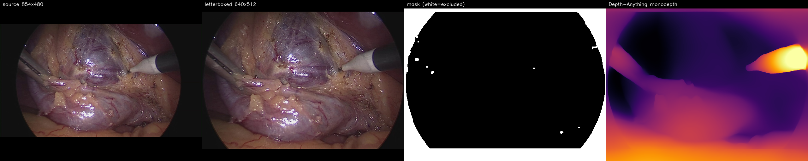
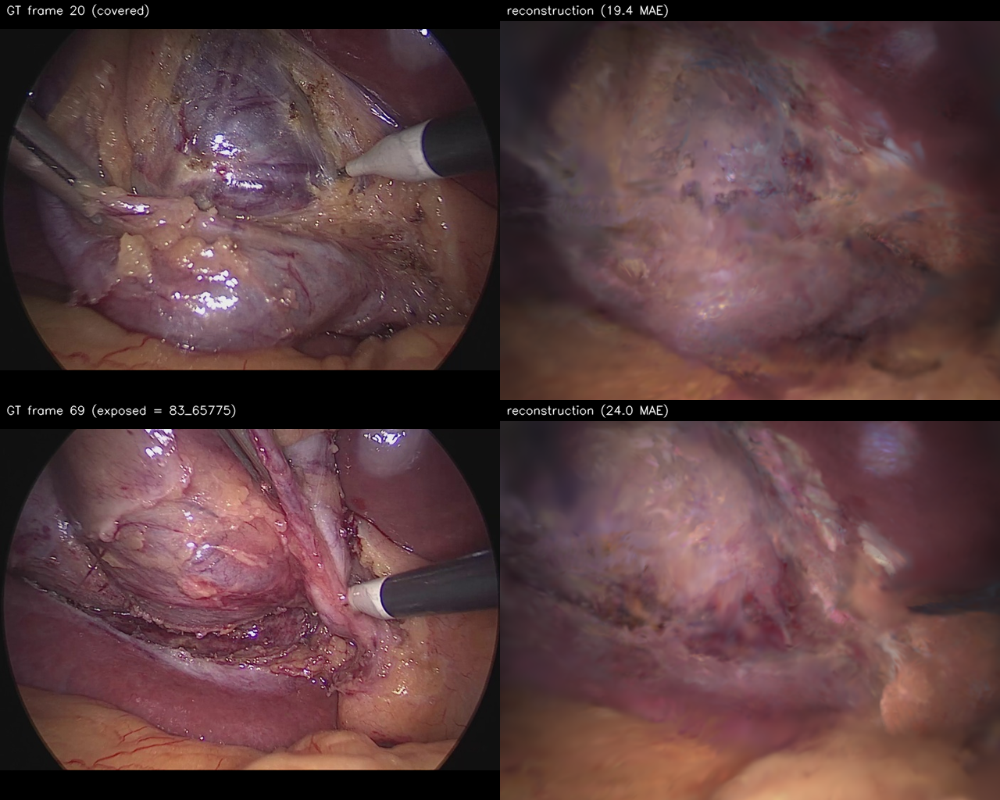
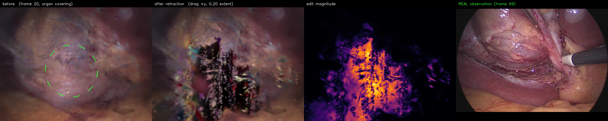
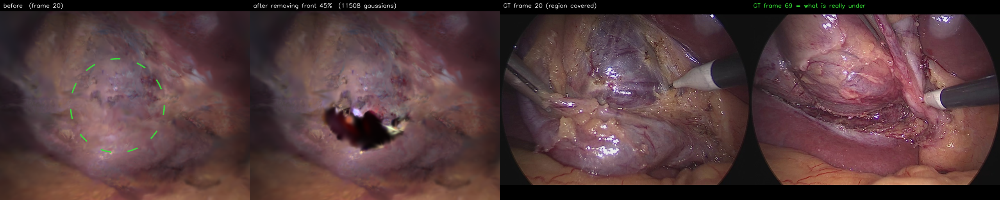
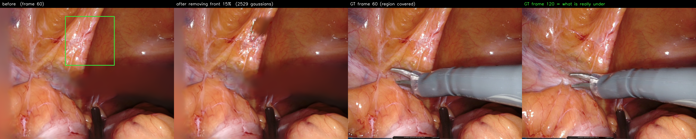

# Endoscapes-CVS201 clip 83 — GC-EndoGaussian reconstruction + retraction reveal

**Goal.** Train GC-EndoGaussian on a laparoscopic cholecystectomy clip, then use the inference-time
edit to retract the tissue covering the hepatocystic groove at an early timestamp and reveal what
lies beneath — with frame `83_65775`, where that region is genuinely exposed, as a ground-truth
reference.

**Status.** Data prep ✅ · Training ✅ · Edit experiments ✅

**Outcome in one line:** the removal edit does **not** work on Endoscapes — the reconstruction is a
single-surface shell with nothing behind it (§3, structural reason) — but the *same tool on the
EndoNeRF `cutting` scene does work* (§3c), because that scene has real stereo depth and a static
endoscope. §4 states what Endoscapes would need.

---

## 1. Data

| | |
|---|---|
| Source | `data/Endoscapes-CVS201/selected/` — 73 JPEGs, `83_64050` → `83_65850`, step 25 |
| Span | ~1800 source frames ≈ **60 s of surgery** |
| Resolution | 854×480, circular vignette |
| Target frame | `83_65775` = **index 69** of 73 |
| Converted scene | `data/endonerf/endoscapes_83/` (73 × {images, monodepth, masks} + `poses_bounds.npy`) |



Endoscapes differs from EndoNeRF/SuPer in three ways that each forced a decision
([tools/endoscapes_to_endonerf.py](../../tools/endoscapes_to_endonerf.py)):

**Monocular — no stereo depth.** SuPer/EndoNeRF are stereo, so `tools/super_to_endonerf.py` gets
depth from `cv2` SGBM for free. Endoscapes is a single laparoscope, so depth has to be *estimated*:
Depth-Anything V2 Small produces `monodepth/`, and the config sets `mode='monocular'` so the depth
term becomes a Pearson correlation on masked pixels (correct for relative, non-metric depth) rather
than an inverse-depth L1.

**No camera poses, and the laparoscope moves.** We assume a **static camera** (`R=I, t=0`), the same
assumption the EndoNeRF/SuPer scenes use, because COLMAP is unreliable on textureless, specular,
deforming tissue. The consequence is quantified in §2 — it is the main cost in this experiment.

**No tool masks.** We mask only the vignette, the letterbox padding, and near-black instrument
shafts — **the metallic instruments are left in the scene**. Every saturation/brightness rule that
covered the graspers also swallowed the pale fat and connective tissue of the hepatocystic triangle,
i.e. exactly the anatomy this clip is for (verified visually). Masking that away would have been far
more damaging than leaving the tools in, so the tools stay and are modeled as moving structures.

Geometry: the content circle (`x=[64,767], y=[0,480]`) is cropped, resized to 640×438 preserving
aspect, and padded 37 px top/bottom to the 640×512 the loader hardcodes — no stretching. Focal is
unknown for this dataset, so a 60° horizontal FOV is assumed (f = 554.3 px).

## 2. Training

`1000 coarse + 3000 fine`, GC-EndoGaussian MATCH recipe (translation-only nodes, dense residual, no
coherence losses, frozen nodes) — [arguments/endoscapes/seq83.py](../../arguments/endoscapes/seq83.py),
[run_endoscapes83.bash](../../run_endoscapes83.bash). One H100, ~6.5 min. Control graph seeded with
**2048 nodes**, so the editing interface is available.

| Stage | PSNR | Note |
|---|---|---|
| Coarse (1000) | 55.9 dB | single viewpoint (frame 0 only) — not a generalization number |
| **Fine (3000)** | **25.64 dB** | across all 73 frames |
| EndoNeRF `pulling` (reference) | 37.0 dB | genuinely static endoscope |



Per-frame mean absolute error: **19.4** (frame 20), **24.0** (frame 69).

**Why 25.6 dB and not 37.** This is structural, not a hyperparameter problem. The clip covers ~60 s
during which the laparoscope moves substantially; with poses forced to static, the 4D deformation
field must explain all of that apparent camera motion as tissue deformation. That burden is what
smooths the renders. The EndoNeRF scenes reach 37 dB because their endoscope really is fixed.

**What survives anyway:** the reconstruction reproduces the anatomy layout, and the render of frame
69 *does* show the dissected groove — so the model demonstrably holds the geometry the reveal needs.
Fine texture and specular detail are lost.

## 3. Edit experiments — negative result

Target: in frame 69 a dark dissected groove runs at roughly `x≈200–420, y≈250–300`; in frame 20 the
same region is covered. Two edit operations were tried.

### 3a. Drag retraction — fails by smearing

[tools/endoscapes_reveal.py](../../tools/endoscapes_reveal.py) grabs control nodes inside a
screen-space disc and translates them. Displacing 37/2048 nodes by 0.20 of scene extent tears the
surface into vertical streaks: grabbed Gaussians move while their unbound neighbours stay, and
everything between stretches.



### 3b. Removal (peel) — clean, but reveals void

[tools/endoscapes_peel.py](../../tools/endoscapes_peel.py) deletes the front-most Gaussians inside a
disc (opacity → 0; the renderer activates `pc._opacity` directly, so this is exactly what the
rasterizer sees) and lets whatever is behind composite through. Mechanically this is clean — a sharp
hole, no smearing — but what appears behind the tissue is **empty background, not anatomy**.

| Variant | In disc | Removed | Pixels changed | Revealed |
|---|---|---|---|---|
| groove, front 30% | 26,100 | 8,375 | 6.6% | black void |
| groove, front 45% | 26,100 | 11,508 | 7.6% | black void |
| groove, front 65% | 26,100 | 22,481 | 12.0% | larger void |
| groove wide (r=170), 45% | 67,534 | **66,561 (98.6%)** | 27.3% | black void |
| upper mass, 45% | 33,707 | 26,342 | 14.8% | black void |
| groove @ frame 35, 45% | 23,772 | 19,047 | 10.9% | black void |



### Why — structural, not a tuning problem

The reconstruction is a **single-surface shell, not a volume**:

1. **Monocular depth gives one depth per pixel.** The initialization is a single sheet; there was
   never a second layer behind it.
2. **The static-pose assumption renders every frame from one viewpoint.** With no parallax the model
   is never required to represent occluded content — so it never learns any.
3. **Frame 69's exposed groove is encoded as a *deformation of that same sheet* at t≈0.95**, not as
   geometry sitting behind the sheet at t≈0.27. Peeling frame 20 therefore cannot uncover it: the
   information is not present in that form.

The wide-disc row is the sharpest evidence — 98.6% of Gaussians in that region lie within the front
part of the depth range, i.e. there is essentially no depth stratification to peel through.

## 3c. The same removal on EndoNeRF `cutting` — this one works

The peel tool was applied unchanged to `output/endonerf/cutting_match` (the paper's Figure-2 scene),
which has what Endoscapes lacks: **real stereo depth and a genuinely static endoscope**. Same
operation, opposite outcome — removing the front layer uncovers *coherent tissue*, not void.



| Removal depth | Gaussians removed | Pixels changed | Result |
|---|---|---|---|
| 15% | 2,529 | 3.2% | front fold gone, clean tissue behind |
| 20% | 3,524 | 4.2% | clean |
| 25% | 4,181 | 4.7% | clean; faint floaters at the edge of observed content |
| 30% | 4,445 | 5.2% | small blurred patch appears — past what was observed |

Other regions behave the same (left tissue rect: 1,094 removed, coherent fold underneath; tool
corridor: 853 removed). One region is a useful null: a disc at (480,180) has almost no depth spread,
so only 199 Gaussians fall in the front band and the image does not change (0.0%) — removal only
does something where there is depth structure to remove.

The honest working band is **15–25%**: deep enough to take the front layer away, shallow enough that
what is behind was actually observed. Video: [`docs/supplementary/peel_cutting.mp4`](../supplementary/peel_cutting.mp4)
(5.2 s, progressive peel to 22% and back).

A related demonstration is visible without any editing at all: in `cutting`, the ground truth
contains a large instrument across the frame while the *reconstruction* shows tissue in its place —
tool pixels are excluded from the photometric loss, so the model fills that region from timestamps
when the instrument was elsewhere.

## 4. What would be required

**Recover real camera poses.** The laparoscope moves substantially across these 60 s; that motion is
genuine parallax which the static-pose assumption currently discards. With poses, the same clip
observes surfaces from multiple angles and can fill occluded volume — the one change that makes
"see underneath" physically possible. It is a substantial piece of work: COLMAP is unreliable on
specular, deforming tissue, so it likely needs a learned pose estimator or endoscopy-specific SfM.

Anything short of that — another frame, a larger removal, a different region — keeps producing void,
because the information was never captured.

**Relation to the paper.** This is a sharper statement of the limitation Reviewers 1 and 5 asked
about. The revised Figure 2 caption and §6 argue that soft revealed regions mark where observation
ends rather than being rendering failures; this experiment shows the extreme case — under strictly
single-viewpoint capture there is no hidden layer at all, and the model correctly shows nothing
rather than inventing tissue.

## Reproduce

```bash
python3 tools/endoscapes_to_endonerf.py --src data/Endoscapes-CVS201/selected \
    --out data/endonerf/endoscapes_83          # needs HF cache for Depth-Anything
sbatch run_endoscapes83.bash                    # monodepth + train + render
sbatch run_endoscapes_peel.bash                 # removal sweep  (tools/endoscapes_peel.py)
sbatch run_endoscapes_reveal.bash               # drag sweep     (tools/endoscapes_reveal.py)
```
