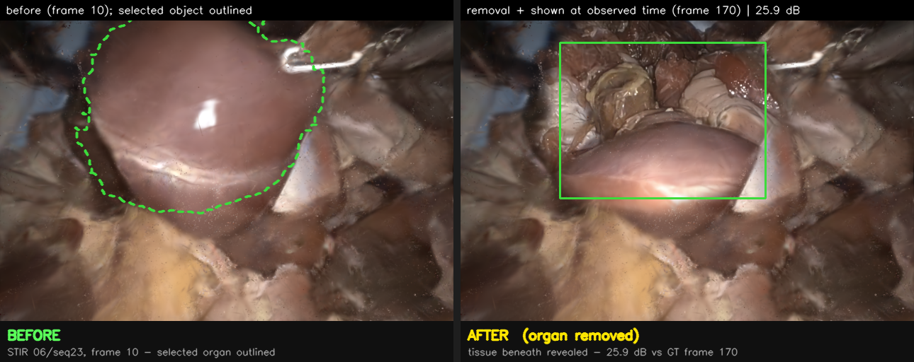
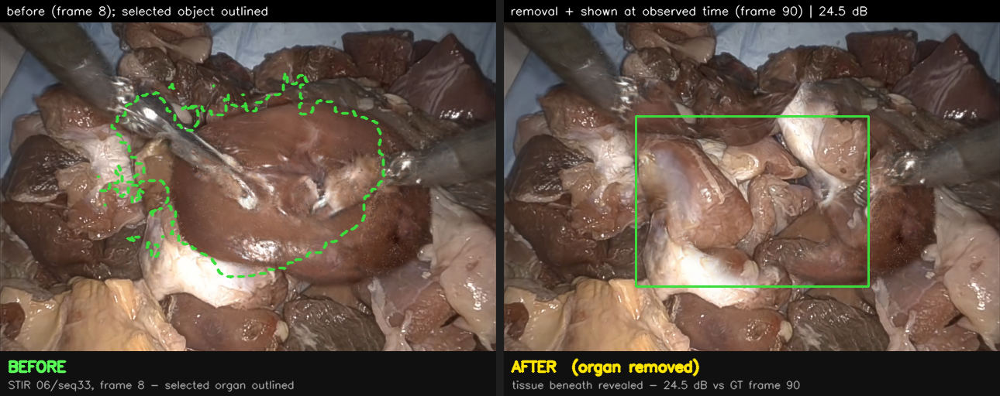
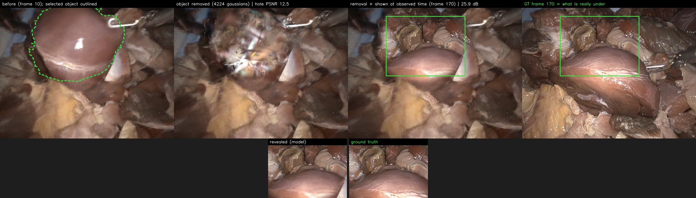
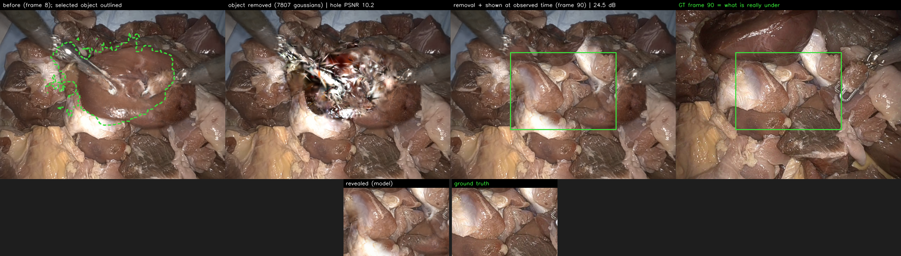
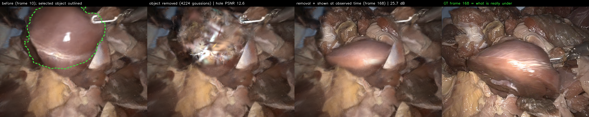
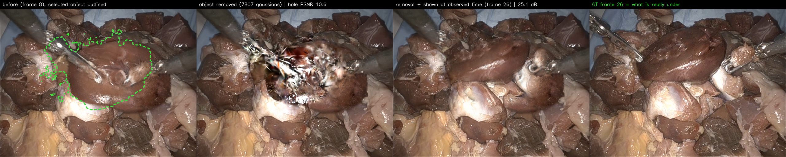
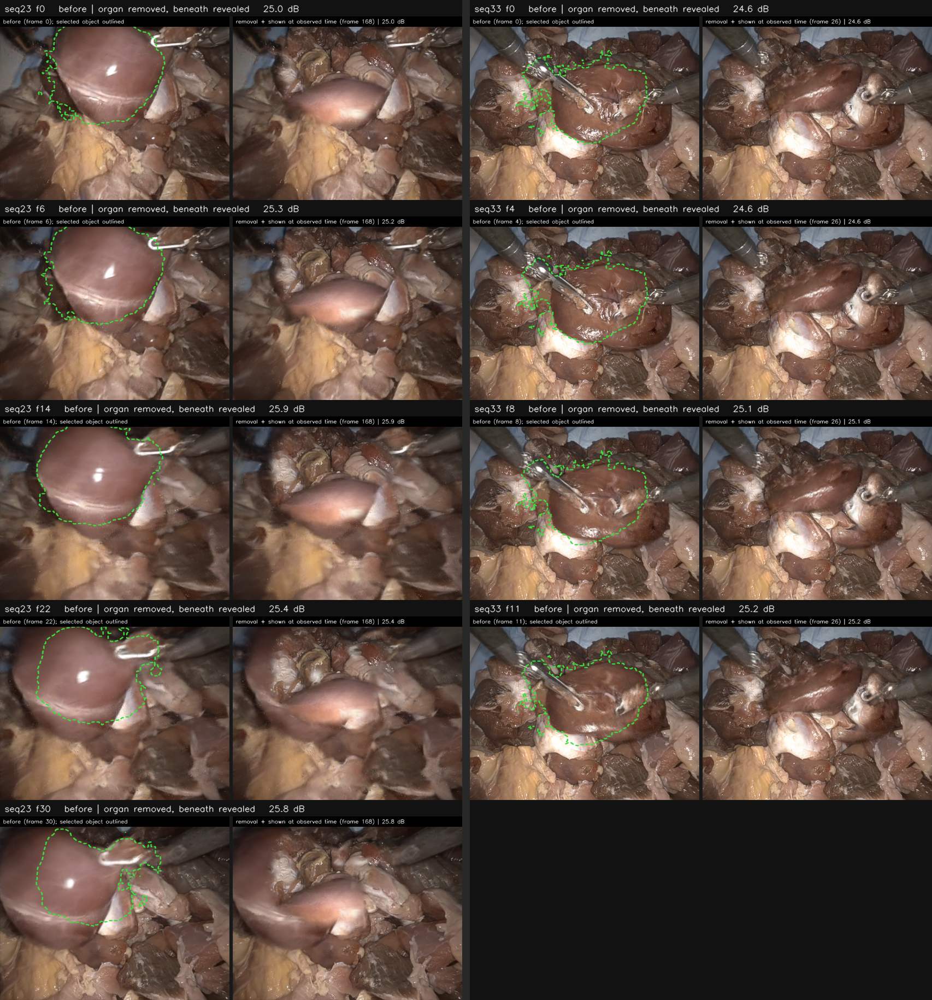
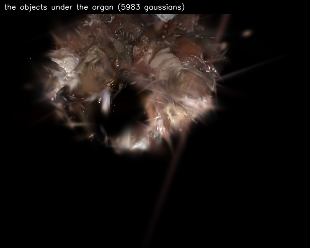
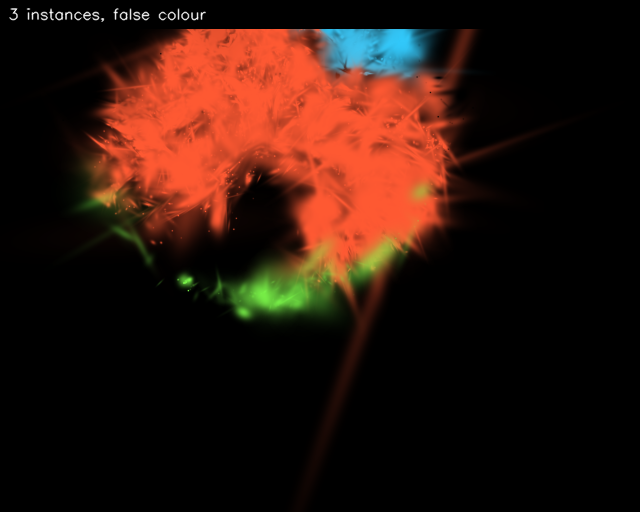
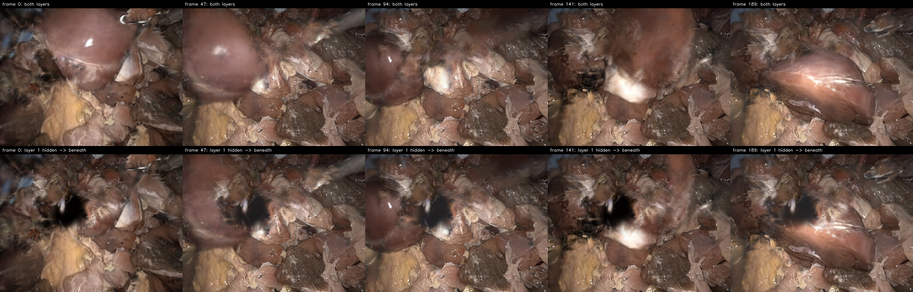

# Removing an organ from the reconstruction and seeing what is beneath it

This document explains, end to end, how the STIR reveal results are produced: what is selected, what
is removed, where the revealed content comes from, how the reference timestamp is found without
human input, and what the method cannot do. It is written so that someone who has not followed the
experiments can reproduce and defend every number.

Figures: `docs/figures/stir_reveal_seq33_v2.png`, `docs/figures/stir_reveal_seq23_v2.png`,
`docs/figures/stir_beforeafter_seq23.png`, `docs/figures/reveal_gallery.png`.

---

## 1. The problem

A trained GC-EndoGaussian model holds one canonical set of Gaussians plus a deformation field that
places them at each timestamp. Deleting the Gaussians of an organ at some timestamp should expose
whatever lies behind it. It does not, and the reason is specific:

While the organ covers the bed, no pixel of that frame depends on the bed's Gaussians, so the
photometric loss gives them **no gradient at that timestamp**. The optimizer is free to park them
anywhere. Their appearance is only constrained at the timestamps where the bed was actually filmed.
Raw removal therefore exposes an unsupervised configuration -- visually, sparkle and floaters --
even though the bed itself is well reconstructed elsewhere in the sequence.

Measured on these scenes: 58.9% (seq33) and 67.6% (seq23) of the Gaussians occluded at the edit
timestamp *are* directly observed at some other timestamp. The information exists; it is indexed
under a different time.

## 2. The pipeline

Implementation: [`tools/stir_object_reveal.py`](../tools/stir_object_reveal.py).

### Step 1 -- select the object

The user supplies a loose footprint (a mask, or a click in the automatic variant). Inside it, the
per-Gaussian view depths are bimodal: the organ sits tens of millimetres in front of the bed. An
Otsu split separates the two clusters and the object is the **entire near cluster**, minus an 8 mm
safety margin so the near rim of the bed is not swallowed. This selects a whole object, not a disc
and not a fixed depth fraction.

The object's exact silhouette is obtained by rendering with the selected Gaussians coloured white
and everything else black: the rasterizer's own alpha blending gives the object's per-pixel
contribution, which is then thresholded.

### Step 2 -- remove it

The selected Gaussians have their opacity set to zero at render time (the renderer activates
`pc._opacity` directly, so this is exactly what the rasterizer sees). Nothing on disk changes and
no retraining occurs; a re-render takes under 5 ms.

### Step 3 -- show the revealed region at the timestamp it was observed

The scene is rendered a second time at a **base frame** -- a timestamp where the region was exposed
to the camera -- and the pixels inside the object's silhouette are taken from that render, with a
feathered seam. Both images are model output; no ground-truth pixels enter the result.

This is valid here because two things are static in these clips: the camera never moves, so the two
renders are pixel-aligned and need no warping, and the bed never moves, so its appearance at the
base frame is also its appearance at the edit frame. Only the organ travels.

### Step 4 -- verify

The revealed region is scored against the real video frame at the base frame, which the model was
never asked to reproduce in this configuration. Reported as "hole PSNR".

## 3. Finding the base frame automatically

Implementation: [`tools/detect_base_frames.py`](../tools/detect_base_frames.py). Runs on CPU in
seconds; needs no model.

The signal is the **median depth inside the object's footprint over time**, taken from the dataset's
stereo depth maps. The region reads shallow while the object rests on it and steps back once the
object is dragged away, so the most exposed frame is the depth maximum, and every frame above the
midpoint of the swing is a usable base frame.

Signals derived from the *reconstruction* were tried first and all fail, for one shared reason: the
deformation field represents the organ's travel by recruiting different Gaussians over time rather
than transporting one set (median per-Gaussian trajectory span is about 2 mm). Consequently the
object's own Gaussians never leave the footprint -- their coverage bottoms out at 48% -- and the
model's rendered depth there swings only about 11 mm across an entire clip. Neither can announce
"the object has left". The input depth can.

Validation, feeding the automatically detected frame into the same pipeline:

| Scene | Hand-picked frame | Auto-detected frame | Manual PSNR | Auto PSNR |
|---|---|---|---|---|
| seq23 | 170 | 168 | 25.9 dB | 25.66 dB |
| seq33 | 90 | 26 | 24.5 dB | 25.12 dB |

Automatic selection matches the manual choice on one scene and beats it on the other, so the
reference timestamp is no longer a hand-tuned parameter.

### 3.1 Two ways the observed state is fetched

The results below use one of two mechanisms. They differ in what carries the timestamp -- the whole
region, or each Gaussian -- and it matters when reading the figures.

| | Single reference frame | Per-Gaussian observed times |
|---|---|---|
| Used by | sections 4.1-4.4, [`tools/stir_object_reveal.py`](../tools/stir_object_reveal.py) | section 4.5, [`tools/extract_under_objects.py`](../tools/extract_under_objects.py), [`tools/auto_reveal.py`](../tools/auto_reveal.py) |
| Timestamp chosen | one per scene, from the depth-in-footprint maximum | one per Gaussian, from the peak of a 5-frame persistence window over its visibility |
| How the content arrives | second render at that frame, composited into the silhouette with a feathered seam | each Gaussian frozen at its own state; times quantised into 8 buckets, one deformation evaluation per bucket |
| Renders | two, blended in image space | one, no compositing |
| Quality | 24.5-25.9 dB | sparser and floatier (see 4.5) |

The single-frame route is the stronger one today. The per-Gaussian route is the more principled one
-- nothing is pasted, and it needs no reference frame at all -- but it currently re-times too few
Gaussians to match the composite.

## 4. Results

### 4.1 The headline result, in one picture

Left: the organ as reconstructed, with the selected object outlined. Right: the same view with that
object removed and the tissue beneath shown.



The same operation on the second scene:



### 4.2 With ground truth and the intermediate step

Four panels: the selected object; removal alone (the unsupervised configuration, 10-13 dB); removal
with the region shown at the timestamp it was observed; and the real video frame that verifies it.
The insets compare revealed content against ground truth.





| Scene | Edit frame | Reference frame | Object removed | Removal only | **Removal + observed time** |
|---|---|---|---|---|---|
| seq23 | 10 | 170 | 4,224 Gaussians (23.9% of frame) | 12.5 dB | **25.9 dB** |
| seq33 | 8 | 90 | 7,807 Gaussians (17.3% of frame) | 10.2 dB | **24.5 dB** |

### 4.3 With the reference frame chosen automatically

Identical pipeline, but the timestamp comes from `tools/detect_base_frames.py` rather than from a
person. seq33's automatic choice (frame 26) scores higher than the frame a human picked (90).





| Scene | Hand-picked | Auto-detected | Manual PSNR | Auto PSNR |
|---|---|---|---|---|
| seq23 | 170 | 168 | 25.9 dB | 25.66 dB |
| seq33 | 90 | 26 | 24.5 dB | **25.12 dB** |

### 4.4 Repeatability across edit timestamps

Nine independent runs -- five edit moments on seq23, four on seq33 -- all using the automatically
detected reference frames. Each pair is before / after. Scores span 24.6-25.9 dB with no failures,
and the selection follows the organ as it shifts between timestamps.



Where the revealed content comes from here: one reference frame per scene, **168 for seq23 and 26
for seq33** (section 3, single-frame route). Those two frames are fixed across the whole gallery;
what varies between examples is the edit timestamp at which the organ is selected and removed.

That is also the caveat to state when presenting it: because each scene's examples draw on the same
source frame, they are nine demonstrations of the *operation* at different edit moments, not nine
independent verifications of the revealed *content*.

### 4.5 The revealed content as objects

The under-organ content can also be extracted as entities in their own right
([`tools/extract_under_objects.py`](../tools/extract_under_objects.py)), and this route uses **no
reference frame at all** -- the timestamp is carried by each Gaussian rather than by the region.

A Gaussian joins the under-set if, at any scanned frame (every 2nd frame, depth agreement within
5%), it is simultaneously on the visible surface *and* projects inside the organ's footprint;
membership is therefore a union over the whole clip rather than a snapshot, minus the organ's own
Gaussians and anything never observed. Each member is then assigned its own timestamp -- the peak of
a 5-frame persistence window over its visibility, i.e. the moment it was most *stably* seen rather
than the first or last time it appeared -- and frozen at the state it held there. To keep the cost
bounded, those timestamps are quantised into 8 quantile buckets and the deformation network is
evaluated once per bucket, after which everything is drawn in a single pass with no compositing.

This mixed-time assembly, not the object extraction itself, is why the result below is sparser and
more floater-prone than the composited reveals in 4.2: only a few thousand Gaussians are re-timed,
where the composite draws on a complete render. Rendered alone on black, with everything else in the
scene hidden:





seq23 yields 5,983 Gaussians in 3 instances (37% shared with the organ); seq33 yields 3,841 in 2
instances (63% shared). The content is real but sparse -- roughly six thousand Gaussians for a
region the full model renders with far more -- so it reads as soft tissue with floater streaks.

## 5. What was tried and did not work

These are recorded because each result constrains what can honestly be claimed.

| Attempt | Outcome |
|---|---|
| Drag the tissue aside instead of removing it | stretches Gaussians into streaks |
| Remove without temporal completion | 6-9 dB: unsupervised configuration, sparkle |
| Tool-masked retraining, time-smoothness, ARAP coherence, SC-GS rigidity | none removes the sparkle; the cause is missing supervision, not regularisation |
| Select the object by motion | fails: per-Gaussian trajectories are about 2 mm, the field recycles primitives |
| Bake layers into the model file ([`tools/bake_layers.py`](../tools/bake_layers.py)) | mechanism works (`_deformation_table` + `layer_id.pth`) but the hole comes out empty |
| Detect base frames from the model's own geometry | blind to the event (48% coverage floor, 11 mm depth swing) |

What the layered attempt produces, across five timestamps with the top layer hidden -- the scene
survives, but the region under the object comes out empty rather than showing the bed:



The layered-file result deserves its own note, because it is the deepest limitation. The intent was
to store the scene as layers so that hiding the top layer would show the bottom one directly, at any
timestamp, with no second render. Freezing the occluded Gaussians at their observed state and
marking them non-deformable is mechanically sound and the file format supports it. It fails because
the layers do not exist to be separated:
[`tools/measure_recruitment.py`](../tools/measure_recruitment.py) measures how many Gaussians serve
as the organ at the edit frame *and* as the visible bed later -- **87.3% on seq33**, 13.1% on seq23.
Where that overlap is high, removing the organ necessarily removes the very primitives that would
show what is beneath. A genuinely layered representation would have to be **trained** with a
foreground/background, occlusion-aware objective; it cannot be recovered afterwards.

## 6. Honest limits

- The revealed content is re-shown, never invented. Regions the camera saw at no timestamp stay soft
  and are not filled in; a diagnostic can mark them explicitly.
- The headline reveals are assembled by compositing two renders in image space (the single-frame
  route of section 3.1). The single-pass alternative that re-times the occluded Gaussians inside the
  rasterizer ([`tools/auto_reveal.py`](../tools/auto_reveal.py)) needs no reference frame but reaches
  only 11-16 dB, because it re-times too few Gaussians. The weakness is in that assembly mechanism,
  not in frame selection -- the same auto-detected frames reach 25 dB through the composite route.
- The method assumes a static camera and a static occluded surface. Both hold in these STIR clips.
- Nothing here is biomechanical. Removing an organ is a visibility operation, not a prediction of
  how tissue would behave.

## 7. Reproduce

```bash
# 1. detect the base frame (CPU, seconds, no model needed)
python3 tools/detect_base_frames.py --scene data/endonerf/stir06_seq23 \
    --mask data/endonerf/stir06_seq23/organ_mask_f10.png

# 2. select the organ, remove it, show what is beneath, score it (GPU)
python3 tools/stir_object_reveal.py --model_path output/stir/seq23_6k_tm \
    --configs arguments/stir/seq23_6k_tm.py --iteration 6000 \
    --frame 10 --ref_frame 168 --mask data/endonerf/stir06_seq23/organ_mask_f10.png \
    --out output/stir/seq23_6k_tm/autoframe

# batch versions
sbatch run_stir_objreveal.bash      # the two headline figures
sbatch run_reveal_gallery.bash      # nine examples across edit timestamps
sbatch run_recruit.bash             # the recruitment measurement behind the layered-file result
```

Models: `output/stir/seq33_6k`, `output/stir/seq23_6k_tm` (GC-EndoGaussian, 1000 coarse + 6000 fine).
Data preparation and scene choice: [`docs/stir_reveal.md`](stir_reveal.md).
