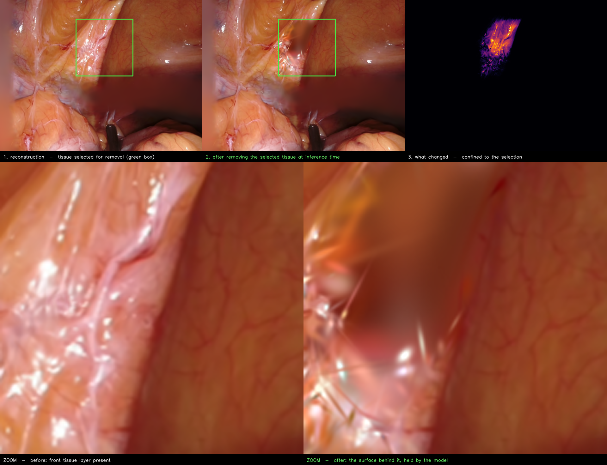

# Removing tissue at inference time to see what is behind it



**Scene:** EndoNeRF `cutting_tissues_twice`, model `output/endonerf/cutting_match` (GC-EndoGaussian,
1000 coarse + 6000 fine). Figure: `tools/make_peel_figure.py`. Video:
[`docs/supplementary/peel_cutting.mp4`](supplementary/peel_cutting.mp4) (progressive peel and back).

## What this shows, and why it is ours and not the baseline's

EndoGaussian already renders tissue where an *instrument* was — but only because tool pixels are
excluded from the photometric loss by a mask supplied **before training**. No editing happens, and
nothing is removed at inference; the occluder was simply never reconstructed. That capability is the
base model's, not ours.

Here we select ordinary, **un-masked tissue** and remove it **at inference time** through the control
interface. The reconstruction then composites whatever it holds behind that tissue. Removing rather
than dragging matters: dragging a region stretches the Gaussians bound to it against their unmoved
neighbours and tears the surface into streaks, whereas removal cannot distort anything.

Mechanism: Gaussians projecting inside the selection are split by view-space depth, and the front
cluster's opacity is set to zero. The renderer activates `pc._opacity` directly
([gaussian_renderer/__init__.py:108](../gaussian_renderer/__init__.py#L108)), so this is exactly
what the rasterizer sees; nothing on disk changes.

## Behaviour vs. removal depth

Removing a fraction of the in-selection depth *range*, on the flap region (rect 240,60–420,240):

| Depth removed | Gaussians | Pixels changed | Result |
|---|---|---|---|
| 15% | 2,529 | 3.2% | front fold gone, coherent tissue behind |
| 20% | 3,524 | 4.2% | clean |
| 22% (figure) | 3,796 | 4.4% | clean |
| 25% | 4,181 | 4.7% | clean, faint floaters at the edge of observed content |
| 30% | 4,445 | 5.2% | a blurred patch appears — past what was ever observed |

**Usable band: 15–25%.** A useful control: a disc at (480,180) has almost no depth spread, so only
199 Gaussians fall in the front band and the image does not change at all (0.0%). The edit only does
something where there is real depth structure to remove — evidence it is peeling geometry rather
than erasing pixels.

## What this does *not* claim

It does not uncover hidden anatomy, and that limit is measured, not assumed. Per-Gaussian visibility
analysis ([tools/find_verifiable_reveal.py](../tools/find_verifiable_reveal.py)) shows that although
45–78% of occluded Gaussians were directly observed at some other timestamp, removing the front
layer still changes only 1–2% of pixels: those Gaussians are the **backing of the same surface**, not
a second anatomical layer. An endoscopic reconstruction from an effectively fixed viewpoint is a
surface *with thickness*, never a layered volume.

This was checked exhaustively and is not a tuning failure:

| Attempt | Outcome |
|---|---|
| Drag retraction, Endoscapes 83 | fails — stretches Gaussians into streaks |
| Remove front layer, Endoscapes 83 | black void — monocular depth gives a single sheet |
| Depth-separation scan, `pulling` / `cutting` | best-separated regions are tissue-vs-background, not tissue-vs-tissue |
| Observed-but-hidden scan, `pulling` / `cutting` | 45–78% observed elsewhere, but only 1–2% pixel change (surface backing) |
| Hamlyn | single pose for all 301 frames — no parallax available |
| **Remove front layer, `cutting`** | **works: coherent tissue behind, 15–25% band** |

Recovering genuinely occluded anatomy needs multi-view parallax, i.e. real camera motion with known
poses. StereoMIS supplies stereo video with da Vinci forward kinematics, but relating those poses to
the optical frame requires a hand-eye calibration; see
[endoscapes83/RESULTS.md](endoscapes83/RESULTS.md) for that investigation.

## Reproduce

```bash
sbatch run_cutting_peel2.bash        # writes peel/frames_flap_video (24-step peel)
python3 tools/make_peel_figure.py \
    --frames output/endonerf/cutting_match/peel/frames_flap_video \
    --rect 240 60 420 240 --zoom 250 70 415 235 --out docs/figures/peel_reveal.png
```
