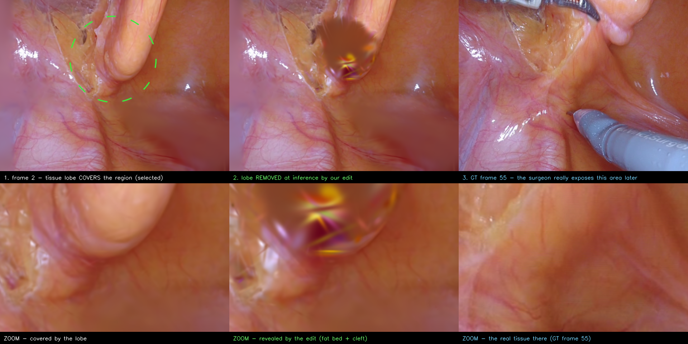

# Masked → revealed by the edit, on real surgery (EndoNeRF `pulling_soft_tissues`)



Video: [supplementary/reveal_pulling_lobe.mp4](supplementary/reveal_pulling_lobe.mp4) (progressive removal and back).

**What happens.** At frame 2 a tissue lobe covers part of the dissection bed. We select it (green
circle) and **remove it at inference time** with the GC-EndoGaussian edit (opacity of the front
Gaussian cluster inside the selection → 0; nothing on disk changes, <5 ms to re-render). The bed
behind it appears — fat and the vessel-marked surface — and **GT frame 55 verifies it**: later in
the video the surgeon really retracts that lobe, exposing the same bed.

**Why this is the method and not the baseline.** EndoGaussian's known trick (tissue where a tool
was) requires the occluder to be *masked out before training*. Here the lobe is ordinary tissue,
fully reconstructed; the removal is an interactive inference-time edit on an arbitrary region.

**Why the reveal is real.** The bed under the lobe is observed at late frames; because the canonical
Gaussian set is shared across time, those Gaussians sit behind the lobe at frame 2 (this scene has
45–51% of occluded Gaussians directly observed at another time — `tools/find_verifiable_reveal.py`).
Removal exposes them. Honest caveats, visible in the zoom: the lobe's attachment area was never
observed at any time and renders as a soft brown patch, and there are floater speckles at the
removal boundary. The lower revealed bed — vessels and fat matching GT 55 — is genuine.

**Recipe** (best of a 5-variant sweep, `run_lobe_peel.bash`):
```bash
python3 tools/endoscapes_peel.py --model_path output/endonerf/pulling_match3k \
  --configs arguments/endonerf/pulling_graph_match_3k.py --iteration 3000 \
  --frame 2 --ref_frame 55 --px 315 --py 165 --pr 120 --front_frac 0.50 --steps 8 \
  --tag lobe_r120_f50 --out output/endonerf/pulling_match3k/lobe_peel
```
Drag variants (`run_flapdrag.bash`, the surgeon's real −x direction) also reveal the bed but smear
the displaced lobe where it lands; removal is the cleaner operation for a still figure.
