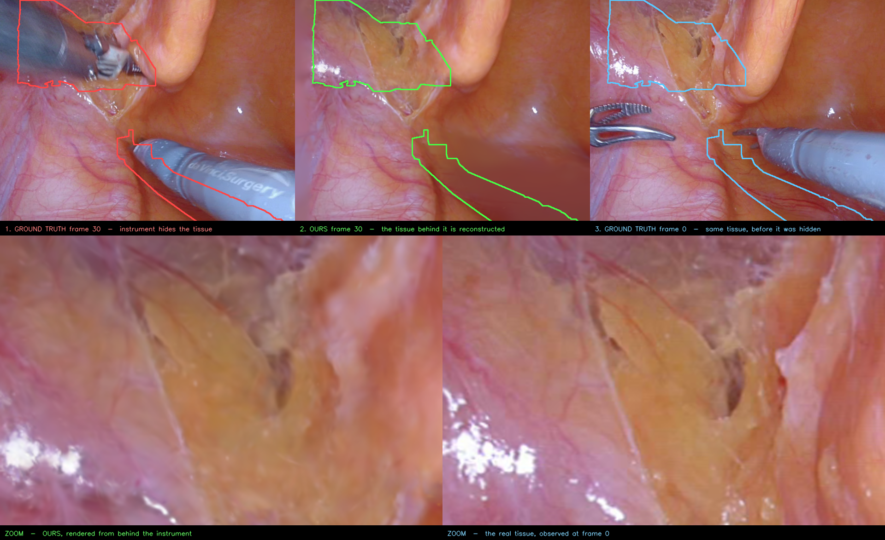

# Showing tissue that is hidden behind an instrument



**Scene:** EndoNeRF `pulling_soft_tissues`, model `output/endonerf/pulling_match3k` (GC-EndoGaussian,
1000 coarse + 3000 fine). Figure built by `tools/make_see_behind_figure.py`.

**What it shows.** At frame 30 a da Vinci instrument covers 39.9% of the field. Our reconstruction
of that same timestamp renders the tissue *behind* the instrument — and frame 0, where the same
tissue was still in plain view, confirms the reconstruction is right: the zoom row matches on the
fatty tissue, the dark cleft, the vessel pattern and the specular highlight.

**Why this is not prediction.** The tissue in the outlined region is directly observed in **35 of 63
frames on average** (minimum 1) — the instrument only covers it for part of the sequence. Because
the canonical Gaussian set is shared across all timestamps and tool pixels are excluded from the
photometric loss, information seen while the region was exposed is still present when rendering a
timestamp where it is occluded. Nothing is hallucinated; the model is re-showing what it already saw.

**How the region was chosen.** For every pair of frames (t, s) we computed how much of the tool
footprint at `t` is still covered at `s`, using the dataset's tool masks, and took the pair with the
least residual overlap. Frame 30 vs frame 0 leaves 21.2% of the frame that is *covered at 30 and
visible at 0* — that is the outlined area, i.e. exactly the part of the claim that ground truth can
verify.

## Relation to the other experiments

| Attempt | Scene | Result |
|---|---|---|
| Drag retraction | Endoscapes 83 | fails — stretches Gaussians into streaks |
| Remove front layer | Endoscapes 83 | reveals black void (single-surface shell, no occluded content) |
| Remove front layer | EndoNeRF `cutting` | works — coherent tissue behind, 15–25% depth band |
| **Occluded-by-instrument** | **EndoNeRF `pulling`** | **works, and is ground-truth verifiable** |

See [endoscapes83/RESULTS.md](endoscapes83/RESULTS.md) for the Endoscapes negative result and why a
monocular clip with no camera poses cannot support this.

## Reproduce

```bash
python3 tools/make_see_behind_figure.py            # CPU only, uses existing renders
```
