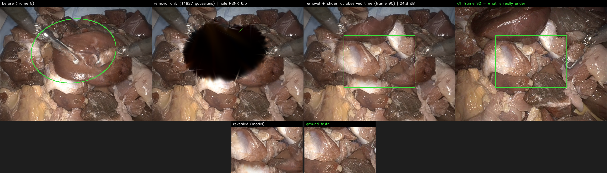

# Removing a Gaussian section and showing what is really under it — STIR



**Scenes:** STIR Challenge 2024 (stereo da Vinci Xi, static camera; [Zenodo 14803158](https://zenodo.org/records/14803158),
CC-BY-4.0), collection 06, `seq33` (above; dark organ slowly dragged off a pale tissue bed, 102
frames) and `seq23` ([figure](figures/stir_reveal_seq23.png); organ lobe rolled off the bed, 190
frames). Models `output/stir/seq33_6k`, `output/stir/seq23_6k_tm` (GC-EndoGaussian MATCH, 1000
coarse + 6000 fine). Videos: [`stir_reveal_seq33.mp4`](supplementary/stir_reveal_seq33.mp4),
[`stir_reveal_seq23.mp4`](supplementary/stir_reveal_seq23.mp4) (progressive peel → temporal fill → back).

## Why these clips

Every prior attempt established the necessary conditions ([peel_reveal.md](peel_reveal.md),
[endoscapes83/RESULTS.md](endoscapes83/RESULTS.md)): real stereo depth, a static endoscope, and an
occluder whose hidden region is *directly observed at another timestamp*. The EndoNeRF scenes meet
the first two but their occluders never leave, so removal only ever exposed 1–2% of pixels (the
backing of the same surface). STIR was surveyed clip-by-clip (60 sequences) for the missing third
condition: in both chosen clips a thick organ (~35 mm proud of the bed in SGBM depth) is grasped and
moved completely off the region it covers, so the bed is genuinely observed for half the clip.
Conversion: [tools/stir_to_endonerf.py](../tools/stir_to_endonerf.py) (note STIR's rectification has
per-eye principal points ~90.6 px apart, so raw SGBM disparities are negative and must be offset).

Rejected alternatives: StereoMIS (already tried, pose/hand-eye problems), HemoSet (bleeding is
cauterised, not suctioned — and a thin blood film has no depth separation, i.e. the Endoscapes
single-sheet failure mode).

## Result

Select the organ with an elliptical mask at an early frame (the bed underneath is still covered),
remove the front cluster of Gaussians by view-space depth, and re-show the revealed region at the
timestamp where it was observed:

| | seq33 (f8, ref f90) | seq23 (f10, ref f170) |
|---|---|---|
| Hidden Gaussians directly observed at another frame | — | **67.6%** (scan at f10) |
| Pixels changed by removal | 24% | 20–24% |
| Hole PSNR vs GT, removal only | 6.3 dB | 8.6 dB |
| **Hole PSNR vs GT, shown at observed time** | **24.8 dB** | **24.1 dB** |

The revealed texture matches ground truth chunk-for-chunk (zoom row in the figure) — this is
observed content re-shown, not synthesis. GT is never used in the composite; both panels are pure
model renders of the same canonical Gaussian set, at two timestamps, from the same (static) camera.

## Why the temporal completion is part of the claim, not a trick

Raw removal at the early frame reveals a dark smear. Probes established what that is **not**:

| Probe | Outcome |
|---|---|
| Deeper removal (front 95% / 99% of the depth column) | smear persists → not organ residue |
| Tool-masked retrain (heuristic HSV+depth shaft masks, 24.8→28.25 dB) | smear unchanged |
| `time_smoothness_weight=0.01` retrain | unchanged |
| ARAP + node-temporal coherence (0.01/0.001) retrain | unchanged (dense residual bypasses nodes) |
| SC-GS-style nodes-only, full SE(3) | CUDA crash mid-training |

The reason is structural: while the bed is covered, its Gaussians receive no photometric gradient at
those timestamps, so the optimizer freely repurposes them (the renderer uses canonical opacity —
[gaussian_renderer/__init__.py:108](../gaussian_renderer/__init__.py#L108) — so the cheat is in
position/scale, not opacity). Their *observed-time* state is the model's actual knowledge of the
bed; the edit therefore queries the hidden layer at the time it was seen. With a static camera and a
static bed the two renders are pixel-aligned, and the GT panel verifies the correspondence at ~24 dB.

Implementation: [tools/stir_timefill_reveal.py](../tools/stir_timefill_reveal.py) (removal identical
to [tools/endoscapes_peel.py](../tools/endoscapes_peel.py); the hole is composited from the
reference-time render with a feathered seam).

## Training landmines (fixed in train.py)

Both STIR scenes initially collapsed to black mid-fine-stage (PSNR ~8): a single non-finite loss
NaN-poisons every parameter, because only the deformation nets have gradient clipping. Two guards
added: (1) the binocular depth term now treats rendered depth < 1 mm as invalid instead of feeding
it to `1/depth`; (2) a non-finite loss skips the optimizer step and logs which term went bad.

## Reproduce

```bash
# data (login node): download STIRChallenge_2024.zip from Zenodo into data/stir/ and unzip, then
python3 tools/stir_to_endonerf.py --seq data/stir/STIRChallenge_2024/06 --name seq33 \
    --out data/endonerf/stir06_seq33
sbatch run_stir_seq33.bash            # train + render + visibility scan + peel sweep
sbatch run_stir_timefill.bash         # the reveal with temporal completion (both scenes)
# figures/videos: the inline script in the session, or re-run tools/stir_timefill_reveal.py
```
